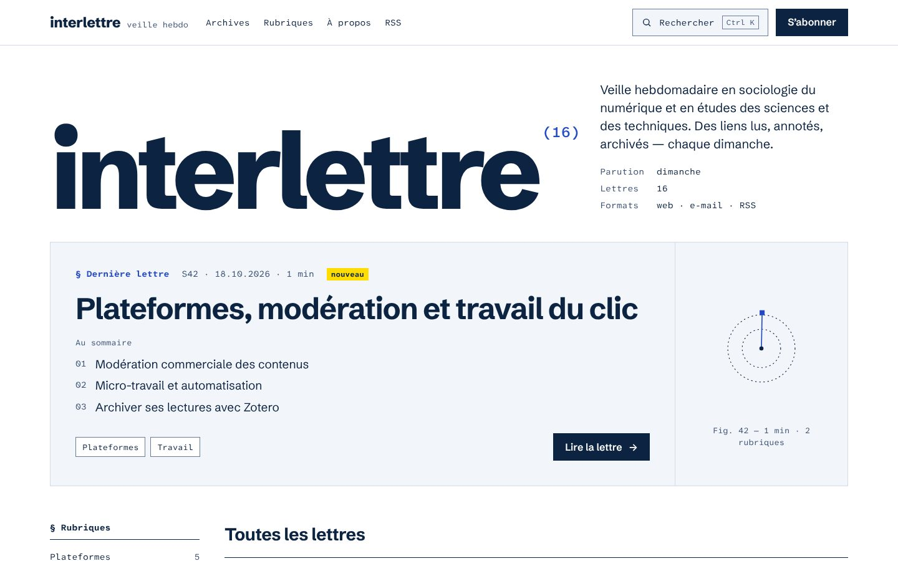

# registre

Thème [Ghost](https://ghost.org) d’**interlettre** (interlettre.info) : un index dense, à l’encre bleue, pour publier une veille hebdomadaire. Mode clair uniquement.

`registre` est un fork de [Zap](https://github.com/TryGhost/Zap) (Ghost Foundation, licence MIT), entièrement réécrit : gabarits, styles, scripts, traductions.



## Ce que fait le thème

- **Accueil en registre** : grand titre avec le nombre de lettres, encadré « Dernière lettre » avec son sommaire, puis l’index de toutes les lettres (semaine, date, titre, rubriques, temps de lecture). Badge « nouveau » pendant 7 jours.
- **Numéro de semaine automatique** : `S42` est calculé à partir de la date de publication (semaine ISO), sans champ à remplir.
- **Sommaire tiré de l’extrait** : dans le champ *Extrait* d’une lettre, séparez les points par des points-virgules (`Modération ; Micro-travail ; Zotero`). Ils s’affichent en liste numérotée sur l’accueil et en chapeau dans la lettre.
- **Fiches de liens** : les cartes « lien » (bookmark) de l’éditeur deviennent des fiches numérotées (`Réf. 01`, `Réf. 02`…). La colonne de gauche en tire un index des liens, et un bouton copie tous les liens au format Markdown.
- **Intertitres numérotés** (`01`, `02`, `03`) dans les lettres (réglable).
- **Citer cette lettre** : référence APA prête à copier, export BibTeX en un clic, et métadonnées `citation_*` / Dublin Core pour que Zotero reconnaisse chaque lettre.
- **Page Archives** : toutes les lettres (jusqu’à 300), regroupées par année, filtrables par rubrique, par année et par titre. Les filtres sont repris dans l’adresse (`/archives/?rubrique=methodes&annee=2026`), donc partageables.
- **Figure générée** pour chaque lettre : un rayon par minute de lecture, un cercle par rubrique (réglable).
- **Accessibilité** : textes contrastés (encre 15,7:1 ; secondaire 7,9:1 ; accent 7,4:1 sur blanc), bordures de commandes ≥ 3:1, focus clavier très visible (surlignage jaune et trait d’encre), lien d’évitement, corps de texte à 19 px, polices très lisibles (Atkinson Hyperlegible Mono pour les données).
- **Polices hébergées dans le thème** (aucun appel à Google Fonts) : Schibsted Grotesk et Atkinson Hyperlegible Mono, licence SIL OFL.
- **Traductions** : français et anglais (`locales/fr.json`, `locales/en.json`), selon la langue du site.
- Sans JavaScript, tout reste lisible et navigable ; seuls les figures, les filtres et les boutons de copie disparaissent.

## Installation

1. Téléchargez `registre.zip`.
2. Ghost Admin › **Settings › Design & branding › Change theme › Upload theme**, puis **Activate**.

### Réglages Ghost conseillés

| Où | Réglage |
| --- | --- |
| General › Title & description | Titre `interlettre`, description de la veille (elle s’affiche sur l’accueil). |
| General › Publication language | `fr` (dates, mois et libellés en français). |
| Design & branding › Brand › Accent color | `#2449C4`, pour accorder Portal et les cartes bouton/inscription. |
| Membership › Portal settings | Désactiver le bouton flottant (« Show portal button ») : l’en-tête a déjà « S’abonner ». |
| Navigation | Par exemple : Archives (`/archives/`), Rubriques (`/tag/<une-rubrique>/`), À propos, RSS (`/rss/`). |
| Newsletters | Le design de l’e-mail se règle dans Ghost (le thème ne s’applique pas aux e-mails) : police sans empattement, couleur `#0C2342` pour les titres et `#2449C4` pour l’accent. |

### Créer la page Archives

1. **Pages › New page**, titre « Archives », slug `archives`.
2. Dans les réglages de la page, **Template** : `Archives`.
3. L’extrait de la page sert de phrase d’introduction. Publiez.

Le lien « Toutes les lettres, avec filtres » apparaît alors dans la colonne de l’accueil et des rubriques.

### Écrire une lettre

- **Rubriques** = étiquettes (tags). La première étiquette est la rubrique principale (utilisée pour « Dans la même rubrique »). Les étiquettes internes (`#…`) ne s’affichent pas.
- **Sommaire** = champ *Extrait*, points séparés par `;`.
- **Liens** = cartes « Bookmark » (collez une URL dans l’éditeur et choisissez *Bookmark*). Ajoutez votre commentaire dans le paragraphe qui suit.
- **Intertitres** = titres de niveau 2 (numérotés automatiquement).
- Encadré « À suivre » = carte *Callout* (couleur jaune pour un surlignage).

## Réglages du thème

Dans **Design & branding › Customize › Theme** :

| Réglage | Effet |
| --- | --- |
| Sous titre | Petit texte à côté du nom dans l’en-tête (`veille hebdo`). |
| Licence | Mention en pied de page (ex. `CC BY 4.0`). |
| Afficher les figures | Active les figures générées. |
| Jour de parution | Ligne « Parution » sur l’accueil. |
| Densité de l’index | Confortable ou compacte. |
| Titre / Texte abonnement | Bloc d’abonnement en bas de page (vide : masqué). |
| Numéroter les sections | Numérotation `01`, `02`… des intertitres. |
| Auteur pour citation | Forme de l’auteur dans la citation (ex. `Martin, R.`). Vide : calculée à partir du nom. |

## Développement

```bash
corepack enable
pnpm install
pnpm test     # GScan : compatibilité Ghost 6
pnpm zip      # dist/registre.zip
```

Pour travailler en direct, liez le dossier dans `content/themes/` d’un Ghost local (`ghost install local`) ; en mode développement, les gabarits sont relus à chaque requête.

### Déploiement automatique

Le workflow `.github/workflows/deploy-theme.yml` (hérité de Zap) teste puis envoie le thème sur votre Ghost à chaque push sur `main`. Créez une intégration personnalisée dans Ghost (Settings › Integrations), puis ajoutez deux secrets au dépôt GitHub : `GHOST_ADMIN_API_URL` (ex. `https://interlettre.info`) et `GHOST_ADMIN_API_KEY`.

### Mises à jour des outils

Dependabot (`.github/dependabot.yml`) ouvre chaque lundi une seule demande de fusion qui regroupe les nouvelles versions des outils GitHub Actions, au moins sept jours après leur sortie. Le test GScan tourne sur cette demande ; la fusionner déclenche le déploiement. `gscan` et `bestzip` se mettent à jour à la main (`pnpm update --latest`), car Dependabot ne gère pas encore pnpm 12.

## Structure

```
assets/css/screen.css      styles (variables de la palette en tête de fichier)
assets/js/registre.js      figures, filtres, copie, citation, BibTeX
assets/fonts/              polices WOFF2 + licences OFL
default.hbs                gabarit commun
index.hbs                  accueil et pages suivantes
post.hbs                   lettre
page.hbs                   page statique
custom-archives.hbs        modèle « Archives » (à choisir sur une page)
tag.hbs, author.hbs        rubrique, auteur
error.hbs                  erreurs
partials/                  en-tête, pied, ligne d’index, dernière lettre, figure, citation, abonnement…
locales/                   fr.json, en.json
```

## Limites connues

- La page Archives charge 300 lettres au plus (trois requêtes de 100, limite de Ghost). Au rythme d’une lettre par semaine, cela couvre près de six ans ; ajoutez un bloc `{{#get … page="4"}}` dans `custom-archives.hbs` au-delà.
- Le numéro de semaine suit la norme ISO : une lettre publiée le 1er janvier peut appartenir à la semaine 53 de l’année précédente.

## Crédits et licence

- Fork de [Zap](https://github.com/TryGhost/Zap), © 2013-2026 Ghost Foundation, licence MIT.
- Modifications © 2026 Raphaël Martin, licence MIT (voir `LICENSE`).
- Schibsted Grotesk et Atkinson Hyperlegible Mono : SIL Open Font License 1.1 (voir `assets/fonts/`).
